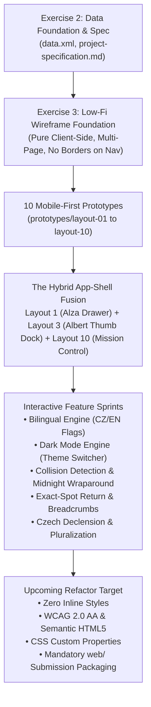

# Instructions for AI Agents and Developers (agents.md)

This document serves as a binding context and guide for any AI model or developer continuing work on the **Festival of Darkness 2** (WebDesignFestival) project.

---

## 1. Running the Website & CORS / Caching Issues

The website is designed as a **pure client-side solution** without installation or backend requirements (as mandated by the semester project assignment).

### A. Local HTTP Server (Recommended)
When developing, use a local HTTP server with **caching disabled (no-cache)**:
```bash
# Run via http-server with cache disabled (-c-1 is critical!)
npx http-server -p 80 -c-1
# or
python -m http.server 8000
```
> **CRITICAL CACHING WARNING:**
> The default setting of `http-server` caches files for 1 hour (`max-age=3600`). When changing navigation links, browsers previously served outdated page versions containing stale hash anchors (`#`). Always run the server with `-c-1` and use hard refresh (**Ctrl + F5**) during testing.

### B. Direct Execution via File System (`file:///`)
If a user or evaluator opens files directly by double-clicking in file explorer:
- Browsers (Chrome, Edge) **block `fetch()` calls** due to CORS security policy on local `file:///` protocol.
- **Code Rule:** Components (`nav` and `footer`) must **never rely solely on asynchronous `fetch()`**. They must either be loaded via `<script src="...">` (e.g., [`components/nav.js`](file:///components/nav.js)), or have static fallback HTML directly inside each page. The script must never overwrite functional DOM with an error message upon fetch failure.

---

## 2. Project Spirit & Design Rules (Wireframes for Exercise 3)

When generating new code or making modifications, strictly adhere to this minimalist visual style:

### 1. Minimalist Wireframe Box Layout
- In this stage, the website serves as a **low-fidelity wireframe**.
- Only basic outlines are used:
  - Main blocks: `border: 1px solid #222; background: #fff;`
  - Nested sub-blocks / cards: `border: 1px solid #777; background: #fafafa;`
- Sections are cleanly separated with a simple `<hr>` element (`border-top: 1px solid #333`).
- **No unnecessary decorations:** Do not add shadows, border radiuses, color gradients, or complex graphical styles unless explicitly requested.

### 2. Navigation and Footer Rules
- **NO BOX / BORDER:** Neither navigation nor footer may be wrapped inside `.wf-box` or have any border!
- **Format:** Simple text row with links side-by-side separated by spacing (`gap` / `margin`).
- **Wrapping (No horizontal scrollbar):**
  - Using `white-space: nowrap` with `overflow-x: auto` is forbidden. The interface must never produce a horizontal scrollbar.
  - Links must wrap naturally and smoothly onto 2 or more lines when the window is narrowed or on mobile devices (`display: flex; flex-wrap: wrap; gap: 10px 18px;`).
- **Festival Brand Name:**
  - The festival name in navigation `[ Festival of Darkness 2 ]` is a link pointing to the homepage (`index.html`).
  - **Must NOT be underlined:** Strict `text-decoration: none;` applies to `.festival-brand`.

### 3. Dedicated Subpages (NO One-Page Web)
- Each section is a **separate HTML file**:
  - `index.html` – Homepage, festival identity, and section directory.
  - `program.html` – Complete performance timetable (school-schedule grid format) with interactive event bookmarking and highlighting.
  - `artists.html` – Complete catalog of all 60 performers (3 per line / 20 lines) with interactive dynamic artist profile details, search, genre filtering, and bookmarking.
  - `stages.html` – Presentation of the 2 stages (*Solar Horizon Stage* & *Lunar Forest Dome*) and venue map.
  - `practical-info.html` – Transportation, camping, cashless, FAQ.
  - `my-schedule.html` – Personal schedule / planner (LocalStorage) with automatic collision detection.
- Navigation links must **always point to actual `.html` files**, never just jump with hash anchors (`#`) within the same page!

### 4. Timetable & Schedule Format (Inspired by University Schedule)
- **Timetable Layout (No Left-to-Right Scrolling):**
  - Modeled after responsive schedule matrices: Hourly time slots down the rows (`13:00–14:00` through `03:00–04:00`) and Stage columns (`Solar Horizon Stage` & `Lunar Forest Dome`).
  - Stacks day-by-day (`Friday, July 10`, `Saturday, July 11`, `Sunday, July 12`) and fits 100% width naturally without any horizontal scrolling (`overflow-x` scrolling is avoided).
- **Interactive Highlighting & Favourites:**
  - Events can be bookmarked by clicking the cell or the `★` button.
  - Bookmarked cells are instantly highlighted (`.is-favourite` with distinct green wireframe styling `background: #d4edda; border: 2px solid #28a745;`).
  - Saved to `localStorage` under `festival_favorites` and synchronized in real time with `my-schedule.html`.
  - Filterable by Day (`Fri`, `Sat`, `Sun`, `All`), Stage (`Solar`, `Lunar`, `Both`), Genre (Quick Genre Pills), and `Only Bookmarked (★)`.


---

## 3. Technical Project Constraints (According to Assignment)

1. **Pure Client-Side:** No Node.js backend, Docker, database, or build process (Vite/Webpack) in the submitted deliverable. Everything must function purely in the browser.
2. **HTML5 Semantics:** Use semantic elements where appropriate: `<header>`, `<nav>`, `<main>`, `<section>`, `<article>`, `<aside>`, `<footer>`, `<time>`, `<address>`.
3. **Data Consistency:** The website is grounded in `project-specification.md` and `data.xml` (Festival of Darkness 2, Kutna Hora, July 10–12, 2026, 3 days, 2 stages, 60 performers).

---

## 4. Comprehensive Project Evolution & Progress History

Understanding the journey of **Festival of Darkness 2** is mandatory before touching any markup, styling, or scripts. The application represents an evolution across course exercises, multiple design iterations, 10 mobile-first layout prototypes, multi-agent boost workflows, and empirical testing.



### 4.1 Chronological Development Trajectory

#### Phase 1: Domain Modeling & Data Foundation (Exercise 1 & 2)
- **Domain Context:** Established a fictional 3-day multi-genre dark alternative & electronic music festival set in the historical mining city of Kutná Hora, Czech Republic (`July 10–12, 2026`).
- **Entity Cardinality & Relational Consistency (`data.xml` & `project-specification.md`):**
  - **2 Distinct Stages:**
    - *Solar Horizon Stage* (`stage-solar`): Open-air main amphitheater with massive visual projection rigs (30 performances total).
    - *Lunar Forest Dome* (`stage-lunar`): Covered, weatherproof geodesic dome providing shelter from rain, hosting intimate dark ambient, industrial, and techno sets (30 performances total).
  - **60 Performers (`perf-01` through `perf-60`):** Complete bilingual biographies, countries of origin, genre classifications, and schedule slot assignments.
  - **60 Schedule Items (`sch-01` through `sch-60`):** Exact 1:1 bijection with performers. Balanced at exactly 20 performances per day (10 per stage per day), running from `13:00` in the afternoon until `04:00` the next morning.
  - **Partitioning by Day:**
    - **Day 1 (Friday, July 10, 2026):** `perf-01` to `perf-20` / `sch-01` to `sch-20`
    - **Day 2 (Saturday, July 11, 2026):** `perf-21` to `perf-40` / `sch-21` to `sch-40`
    - **Day 3 (Sunday, July 12, 2026):** `perf-41` to `perf-60` / `sch-41` to `sch-60`

#### Phase 2: Wireframe Foundation & Rejection of SPA Hash Routing (Exercise 3)
- **Strict Wireframe Visual Constraints:** The course mandates low-fidelity wireframes using simple outlines (`border: 1px solid #222` for main blocks, `border: 1px solid #777` for nested sub-cards, and `<hr>` dividers). Unnecessary graphical decorations (gradients, shadows, rounded corners) were strictly prohibited.
- **Dedicated Multi-Page Architecture:** Early AI attempts tried to build a single-page application (SPA) with hash anchor jumping (`#program`, `#artists`). The project owner pushed back and mandated a dedicated multi-page architecture:
  - [`index.html`](file:///c:/Users/Administrator/Desktop/webapp/WebDesignFestival/index.html) – Homepage, festival identity, mission control telemetry, and section directory.
  - [`program.html`](file:///c:/Users/Administrator/Desktop/webapp/WebDesignFestival/program.html) – Complete 2D schedule timetable matrix.
  - [`artists.html`](file:///c:/Users/Administrator/Desktop/webapp/WebDesignFestival/artists.html) – 60-artist catalog (3 per row / 20 rows) with live search and genre filters.
  - [`artist-detail.html`](file:///c:/Users/Administrator/Desktop/webapp/WebDesignFestival/artist-detail.html) – Dynamic artist profile, audio waveform preview, and exact-spot return.
  - [`stages.html`](file:///c:/Users/Administrator/Desktop/webapp/WebDesignFestival/stages.html) – Stage comparison, venue maps, and direct links to stage timetables.
  - [`practical-info.html`](file:///c:/Users/Administrator/Desktop/webapp/WebDesignFestival/practical-info.html) – Transportation, shuttle bus timetables, camping, cashless, and FAQ.
  - [`my-schedule.html`](file:///c:/Users/Administrator/Desktop/webapp/WebDesignFestival/my-schedule.html) – Personal schedule planner with automated collision detection.
- **The School-Schedule Timetable Metaphor:** Modeled after university timetables, the schedule matrix arranges hourly slots down the rows (`13:00–14:00` through `03:00–04:00`) and the two stages across the columns. This layout fits 100% of mobile screens vertically without triggering horizontal scrollbars.

#### Phase 3: The 10 Mobile-First Wireframe Prototypes
To discover the most ergonomic mobile experience, 10 fully working wireframe prototypes were built under [`prototypes/`](file:///c:/Users/Administrator/Desktop/webapp/WebDesignFestival/prototypes/):
1. **Layout 1 (App-Shell / Alza Flyout Drawer):** Top bar with a slide-out drawer containing the complete navigation tree.
2. **Layout 2 (Bottom Sheet):** Dynamic draggable bottom sheet for contextual details.
3. **Layout 3 (Albert Thumb-Zone Dock):** Fixed 5-button bottom dock modeled after the *Můj Albert* mobile app for easy thumb reach.
4. **Layout 4 (Accordion Stack):** Vertically collapsible day and stage panels.
5. **Layout 5 (Timeline Ribbon):** Continuous chronological event stream.
6. **Layout 6 (Tab Carousel):** Swipeable horizontal day cards.
7. **Layout 7 (Floating Action Dock):** Detached floating dock hovering above content.
8. **Layout 8 (Horizontal Snap Deck):** Card-snapping stage views (rejected due to horizontal scroll friction).
9. **Layout 9 (Swiss Grid):** Dense typographic hierarchy and strict Swiss grid outlines.
10. **Layout 10 (Mission Control Dashboard):** Real-time operational telemetry (festival clock, weather radar status, stage shelter status) with an emergency 1-click rain shelter triage banner.

#### Phase 4: The Ergonomic Hybrid Fusion
Instead of choosing a single prototype, the team synthesized a hybrid layout combining the strengths of Layout 1, Layout 3, and Layout 10:
- **Top App Bar & Alza Flyout Drawer:** Houses the festival brand, the sticky navigation header, quick language toggle, dark mode toggle, and the hamburger button (`#menu-drawer-open-btn`) which opens the full drawer containing secondary links (*Practical Info*, *Stages*).
- **Albert Bottom Thumb-Zone Dock:** Pinned at the bottom of the viewport with a fixed 5-button layout designed around Fitts's Law (`[ 🎤 Artists ]` – `[ ⛺ Stages ]` – `[ 🏠 HOME ]` – `[ 📅 Program ]` – `[ ★ My Schedule ]`). Crucially, the central `[ 🏠 HOME ]` button is placed directly in the thumb reach zone, and `padding-bottom: 78px` on `<body>` guarantees content is never obscured.
- **Mission Control Telemetry & Rain Triage:** On `index.html`, a live telemetry bar displays real-time weather and stage status, accompanied by a high-contrast emergency banner (`[ Move Under Cover (Lunar Forest Dome) → ]`) fulfilling Scenario 1 (immediate rain shelter navigation in ≤ 2 taps).

#### Phase 5: Feature Sprints, Dark Mode & Multi-Agent Hardening
- **Bilingual Localization Engine (`js/lang.js`):** Client-side switching between Czech (`cs`) and English (`en`) using `data-i18n` attributes and dynamic component updates.
- **Dark Mode Engine (`js/theme.js` & `css/wireframe.css`):** Persistent `html.dark-mode` class in `localStorage`, maintaining strict wireframe contrast across light (`#fff` / `#fafafa` / `#222`) and dark (`#121212` / `#1e1e1e` / `#444`) themes.
- **Exact-Spot Return & Highlight Animation:** Returning from `artist-detail.html` back to `artists.html` or `program.html` restores scroll position and flashes a pulse border (`.spot-highlight`).
- **Sticky Navigation Bar:** Pinned `#nav-placeholder` with `position: sticky; top: 0; z-index: 1000;` and `scroll-padding-top` on `html` for smooth anchor jumping.
- **Czech Morphological Declension:** Grammatically correct Slavic pluralization for counters (1 vs 2–4 vs 5+ items) across favorites, artists, and schedule collision warnings.
- **Automated Test Harness (`tests/`):** 6 automated Node.js test suites with 215+ assertions validating static markup, accessibility, dynamic behavior, bilingual purity, dark mode persistence, and collision logic.

---

## 5. Post-Mortem: Where the Project Got Stuck & Recurring AI Traps

During development, multiple AI agents encountered recurring roadblocks and architectural traps. Every developer and model working on this codebase must study these post-mortem findings to avoid regressing established solutions.

```mermaid
flowchart LR
    subgraph BUGS["Historical Bottlenecks & Failure Modes"]
        B1["1. file:/// CORS Fetch Trap<br/>(Components wiped out)"]
        B2["2. HTTP Server Cache (-c-1)<br/>(Stale hash anchors)"]
        B3["3. Decorative Style Leakage<br/>(Shadows, gradients, radiuses)"]
        B4["4. Mobile Horizontal Overflow<br/>(white-space: nowrap)"]
        B5["5. Language Switcher Traps<br/>(Bilingual slashes, drawer close)"]
        B6["6. Czech Pluralization Bugs<br/>(1 uložených vystoupení)"]
        B7["7. Day-Filter Mismatch (5 vs 3)<br/>(perf-XX vs date format in favs)"]
        B8["8. Collision Midnight Wraparound<br/>(00:30 treated as earlier than 23:30)"]
        B9["9. Dark Mode Specificity Battles<br/>(Inline colors overriding dark CSS)"]
        B10["10. UTF-8 Mojibake Corruption<br/>(Windows replacement char U+FFFD)"]
    end
```



### 1. The `file:///` Protocol CORS Fetch Trap
- **The Issue:** AI agents initially built `components/nav.js` and `components/footer.js` using asynchronous `fetch('components/nav.html')`. When evaluators or users opened files directly via Windows Explorer (`file:///C:/.../index.html`), modern browsers (Chrome, Edge) threw CORS errors. The scripts caught the error and overwrote the DOM with an error message, completely breaking navigation.
- **The Resolution:** Components must use static fallback HTML already present inside the page or synchronously injected DOM templates. The script must never replace functional DOM with error placeholders upon fetch failure.

### 2. HTTP Server Caching (`max-age=3600`) Serving Stale DOM
- **The Issue:** When testing with `npx http-server`, the default caching behavior cached files for 1 hour. When links were changed from hash anchors (`#program`) to multi-page paths (`program.html`), the browser continued serving outdated versions, leading developers to believe their code was broken.
- **The Resolution:** Always run the development server with caching disabled: `npx http-server -p 8080 -c-1` and use hard refreshes (`Ctrl + F5`).

### 3. Decorative Style Leakage vs. Low-Fi Wireframe Rules
- **The Issue:** Multiple AI models repeatedly attempted to "beautify" the interface by injecting modern CSS: rounded corners (`border-radius: 8px`), drop shadows (`box-shadow: 0 4px 12px rgba(0,0,0,0.15)`), linear color gradients, and wrapping the top navigation bar or footer inside bordered wireframe boxes.
- **The Resolution:** Strict enforcement of Section 2 rules:
  - Neither navigation nor footer may have a border or be inside `.wf-box`.
  - All borders must be sharp `0px` corners: `border: 1px solid #222` (main) and `border: 1px solid #777` (sub-cards).
  - Color is strictly reserved for functional state indication: Green (`#d4edda` / `#28a745`) for bookmarked sets, Red (`#ffebee` / `#b71c1c`) for schedule collisions, and Muted Yellow (`#fff3cd`) for covered stage shelter badges.

### 4. Mobile Horizontal Viewport Overflow (`overflow-x`)
- **The Issue:** AI agents introduced `white-space: nowrap` and `overflow-x: auto` on navigation links, genre filter pill ribbons, and timetable grids. On narrow mobile viewports (`375px` iPhone SE), this produced awkward horizontal scrollbars and broken thumb ergonomics.
- **The Resolution:** Enforce `display: flex; flex-wrap: wrap; gap: 8px;` on all button groups, breadcrumbs, and link ribbons. The timetable must use responsive column widths without wrapping the entire table in a horizontally scrollable container.

### 5. Language Switcher Traps: Slashes, Flag Desync & Drawer Annihilation
- **The Issue:**
  1. Early templates used hybrid slash text such as `Program / Harmonogram` or `Artists / Účinkující`. This violated clean localization standards and failed test suites.
  2. Clicking the language switcher inside the open Alza drawer re-rendered the entire navigation component, causing the drawer to instantly snap shut and losing the user's context.
  3. Flag icons got desynchronized (e.g. displaying the GB flag when English was already active, confusing users as to whether the flag indicated current language or target action).
- **The Resolution:** Use SVG flag icons representing the active language state with an explicit label (`EN` / `CZ`). When switching languages, update text nodes via `data-i18n` in-place without re-rendering or destroying the drawer DOM.

### 6. Czech Morphological Declension & Pluralization Traps
- **The Issue:** In chat `04060603`, the user uploaded a screenshot showing the grammatically incorrect phrase `1 uložených vystoupení`. Naive string concatenation `${count} uložených vystoupení` failed Slavic grammar rules.
- **The Resolution:** Implemented proper three-case Slavic pluralization across all dynamic counters:
  ```javascript
  function formatCzechShowsCount(count) {
      if (count === 1) return '1 uložené vystoupení';
      if (count >= 2 && count <= 4) return `${count} uložená vystoupení`;
      return `${count} uložených vystoupení`;
  }
  function formatCzechClashCount(count) {
      if (count === 1) return '1 časová kolize';
      if (count >= 2 && count <= 4) return `${count} časové kolize`;
      return `${count} časových kolizí`;
  }
  function formatCzechArtistCount(count) {
      if (count === 1) return '1 interpret';
      if (count >= 2 && count <= 4) return `${count} interpreti`;
      return `${count} interpretů`;
  }
  ```

### 7. The Day-Filter Discrepancy Bug ("5 Favorites Selected, but Only 3 Shown")
- **The Issue (Chat `288e6c95`):** The bottom dock badge showed `[ ★ My Schedule (5) ]`, but when opening `my-schedule.html` under the Friday tab, only 3 performances were visible. Two bookmarked performances vanished from the day view.
- **Root-Cause Analysis:**
  - `artists.html` saved bookmarked items with `day` set to full localized date strings (e.g., `"Friday, July 10, 2026"`).
  - `program.html` saved bookmarked items with `day` set to `"Day 1: Friday, July 10"`.
  - `my-schedule.html` filtered favorites by checking `f.day && f.day.includes(d.key)`, where `d.key` was `"Day 1"`.
  - Because `"Friday, July 10, 2026"` did not contain the substring `"Day 1"`, the filter returned `false` and excluded the performance!
- **The Resolution:**
  - Day filtering must not rely solely on naive string substring matching.
  - Implement canonical ID-to-Day mapping using the known dataset partition:
    - `perf-01` to `perf-20` → Day 1 (Friday, July 10)
    - `perf-21` to `perf-40` → Day 2 (Saturday, July 11)
    - `perf-41` to `perf-60` → Day 3 (Sunday, July 12)
  - Helper function `isFavoriteInDay(item, dayKey)` checks both the ID range and normalized day strings.

### 8. Midnight Wraparound in the Collision Detection Engine
- **The Issue:** Performances run past midnight until `04:00` (e.g., `23:30–00:45` on Solar Stage and `00:15–01:30` on Lunar Dome). Standard string comparisons or naive hour extraction treated `00:15` as less than `23:30`, failing to detect that the two shows overlap in real time.
- **The Resolution:** Time normalization onto a continuous minute axis where post-midnight hours (`00:00` to `07:59`) receive an offset of $+1440$ minutes ($24 	imes 60$):
  ```javascript
  function parseTimeToMinutes(timeStr) {
      const [hours, minutes] = timeStr.split(':').map(Number);
      const normalizedHours = (hours < 8) ? hours + 24 : hours;
      return normalizedHours * 60 + minutes;
  }
  ```

### 9. Dark Mode Specificity Wars & Dynamic Styling Clashes
- **The Issue:** Over 210 inline `style="..."` attributes in HTML and 100+ dynamic style injections in JavaScript (e.g. injecting `style="color: #222;"` into artist biography paragraphs or `style="background: #fff3cd;"` into warning boxes) had higher CSS specificity than stylesheet rules. In dark mode, `#222` dark text on `#121212` dark background became completely unreadable.
- **The Resolution:**
  - Eliminating inline styles in favor of semantic classes (`.artist-detail-bio-text`, `.stage-link`).
  - Strict hex color contract for test assertions: dark mode text uses `#a6a6a6` for muted descriptions and `#e0e0e0` for primary text.

### 10. UTF-8 Mojibake Corruption (`U+FFFD`)
- **The Issue:** Editing files on Windows using mismatched command-line encodings corrupted Czech diacritics (`ě`, `š`, `č`, `ř`, `ž`, `ý`, `á`, `í`, `é`) into replacement characters ( / `U+FFFD`) inside `practical-info.html`, `my-schedule.html`, `js/schedule.js`, and `js/artist-detail.js`.
- **The Resolution:** All files must be read and written in strict UTF-8 without BOM. Automated tests now include a static scan checking for `U+FFFD`.

---

## 6. The Refactoring Blueprint: Architecture, Strict Invariants & What Future AI Must Pay Attention To

The upcoming comprehensive refactor (`plan_project_refactor.md`) aims to eliminate all accumulated technical debt: eliminating all inline styles, establishing full semantic HTML5 compliance, tokenizing CSS variables, and preparing the official submission packaging.

Future developers and AI agents refactoring this project **MUST obey the following invariants**:

### A. The Directory Structure Dilemma: Root Development vs. `web/` Submission
- **The Assignment Mandate (`zadani.txt`):** The final semester submission archive must have the structure:
  ```text
  projekt/
  ├── project-specification.md
  ├── prototype/ (or prototypes/)
  ├── documentation.md
  ├── data.xml
  ├── web/
  │   ├── index.html, program.html, artists.html, artist-detail.html, stages.html, practical-info.html, my-schedule.html
  │   ├── css/wireframe.css
  │   ├── js/*.js
  │   ├── img/*.svg
  │   └── components/*.html, *.js
  └── review/
  ```
- **The Development Trap:** All existing automated test suites (`tests/*.js`) execute against files at the repository root (`path.join(ROOT_DIR, 'artist-detail.html')`). Moving root files directly into `web/` without a strategy will break all test runners.
- **The Architectural Solution:** Keep canonical source files at the repository root during active development and testing. Implement an automated packaging/mirroring script (`scripts/package_submission.js`) that verifies and copies the clean web assets into `web/` upon build or commit. Both locations must remain 100% in sync.

### B. Frozen Test Selectors, Element IDs & Literal Values (DO NOT RENAME)
The test harness runs over 215 automated assertions. Any refactor that changes or removes these exact selectors will fail regression tests:

| Test-Guarded Identifier | Type | Required Location | Purpose / Asserted Rule |
| :--- | :--- | :--- | :--- |
| `.spot-highlight` | CSS Class | `css/wireframe.css` | Exact-spot return pulse animation border |
| `@keyframes spot-pulse-highlight` | CSS Rule | `css/wireframe.css` | Animation keyframe for spot return |
| `.stage-nav-tabs` | CSS Class | `css/wireframe.css` | Stage navigation pills on `stages.html` |
| `.sch-detail-btn` | CSS Class | `css/wireframe.css` | Timetable cell detail action button |
| `.stage-link` | CSS Class | `css/wireframe.css` | Stage link inside artist detail |
| `.artist-detail-meta-text` | CSS Class | `css/wireframe.css` | Metadata label in artist detail view |
| `.artist-detail-bio-text` | CSS Class | `css/wireframe.css` | Biography text container |
| `html.dark-mode .artist-detail-bio-text` | CSS Selector | `css/wireframe.css` | Dark mode biography override |
| `html.dark-mode .stage-link` | CSS Selector | `css/wireframe.css` | Dark mode stage link override |
| `#a6a6a6` | Hex Color | `css/wireframe.css` | Asserted dark-mode muted text color |
| `html.dark-mode svg rect[fill="#fff3cd"]` | CSS Selector | `css/wireframe.css` | SVG venue map yellow highlight override in dark mode |
| `#theme-switch-btn` | DOM ID | `components/nav.html` | Top bar theme switcher button |
| `#theme-switch-btn-drawer` | DOM ID | `components/nav.html` | Drawer theme switcher button |
| `#lang-switch-btn` | DOM ID | `components/nav.html` | Top bar language switcher button |
| `#menu-drawer-open-btn` | DOM ID | `components/nav.html` | Hamburger drawer open button |
| `.festival-brand` | CSS Class | `components/nav.html` | Un-underlined festival title link |
| `.fav-count-badge` | CSS Class | Navigation / Shell | Live count of bookmarked favorites |
| `#my-schedule-container` | DOM ID | `my-schedule.html` | Container where schedule items render |
| `.is-favourite` | CSS Class | `css/wireframe.css` | Visual bookmark highlight (`#d4edda` / `#28a745`) |
| `.col-solar`, `.col-lunar` | CSS Classes | `program.html` | Stage columns in timetable matrix |
| `#artist-search-input` | DOM ID | `artists.html` | Performer search input field |
| `#filtered-count` | DOM ID | `artists.html` | Performer counter badge |
| `#filter-fav-only` | DOM ID | `artists.html` | Filter to bookmarked performers toggle |
| `#preview-play-btn` | DOM ID | `artist-detail.html` | Simulated audio waveform play button |
| `#profile-star-btn` | DOM ID | `artist-detail.html` | Performer profile favorite toggle |
| `id="perf-01"` .. `id="perf-60"` | DOM IDs | `artists.html` | Individual performer card IDs |
| `id="sch-01"` .. `id="sch-60"` | DOM IDs | `program.html` | Individual schedule timetable cell IDs |

### C. Zero Inline Styles Policy
- **HTML Files:** Strip every `style="..."` attribute from `index.html`, `program.html`, `artists.html`, `artist-detail.html`, `stages.html`, `practical-info.html`, `my-schedule.html`, `components/nav.html`, and `components/footer.html`.
- **JavaScript Files:** Replace dynamic style string injections in `js/schedule.js`, `js/artist-detail.js`, and `js/artists.js` with semantic CSS class toggles (`.conflict-alert-box`, `.conflict-clean-box`, `.is-favourite`, `.is-favourited`, `.audio-preview-box`, `.is-hidden`).
- **CSS Architecture:** Refactor [`css/wireframe.css`](file:///c:/Users/Administrator/Desktop/webapp/WebDesignFestival/css/wireframe.css) using CSS Custom Properties (`--wf-*` tokens) for all theme variables, while strictly retaining the test-guarded explicit selector blocks.

### D. Semantic HTML5 & WCAG 2.0 AA Accessibility Checklist
Every page must pass the grading rubric in `zadani.txt`:
1. **Heading Hierarchy (`<h1>`–`<h3>`):** Every page must have exactly one top-level `<h1>` representing the page title, followed by logical `<h2>` and `<h3>` headings without level skips.
2. **Accessible Skip-to-Content Link:** Add `<a href="#main-content" class="skip-link" data-i18n="skip_to_content">Skip to main content</a>` at the top of the header, jumping to `<main id="main-content">`.
3. **Table Accessibility:**
   - Add `<caption class="sr-only">` to all schedule tables in `program.html`.
   - Add `scope="col"` to column headers and `scope="row"` to time-slot headers.
   - Wrap all performance time ranges in `<time datetime="HH:MM">` elements.
4. **Semantic Tags:**
   - Wrap 60 performer cards in `<article class="col wf-box-sub" id="perf-XX">`.
   - Wrap festival contacts and venue locations in `<address>`.
5. **AEO / GEO / SEO Structured Data:** Maintain Schema.org JSON-LD blocks on every page (`Festival` on `index.html`, `ItemList`/`MusicGroup` on `artists.html`, `Place`/`MusicVenue` on `stages.html`, `FAQPage` on `practical-info.html`).

### E. Dedicated Search Showcase (`search.html` vs In-Page Live Search)
- `zadani.txt` specifies: *"vyhledávání (vyhledávací pole i stránka s výsledky), Může být statická ukázka výsledků určitého stringu"*.
- **Strategy:** Maintain the instant live filtering on `artists.html` and `program.html` (which visitors rely on in real time), and introduce a lightweight dedicated [`search.html`](file:///c:/Users/Administrator/Desktop/webapp/WebDesignFestival/search.html) results showcase accessible via a search input in the Alza drawer. This provides full compliance with the course rubric while preserving live interactive performance.

---

## 7. Pre-Commit Verification Protocol for AI Agents

Before declaring any refactoring task complete or pushing commits to git, run the following automated verification suite:

```bash
# 1. Execute all automated functional, dark-mode, navigation, and bilingual test suites
node tests/artist_detail_and_breadcrumbs_test.js
node tests/dark_mode_test.js
node tests/bottom_switcher_test.js
node tests/lang_switcher_test.js
node tests/sticky_nav_test.js
node tests/e2e_test_runner.js
node tests/challenger_1_m0_r2_suite.js
node tests/challenger_1_m1_suite.js

# 2. Verify ZERO UTF-8 replacement characters (\uFFFD) exist in the codebase
node -e "
const fs = require('fs');
const files = ['index.html','program.html','artists.html','artist-detail.html','stages.html','practical-info.html','my-schedule.html','js/schedule.js','js/artists.js','js/artist-detail.js','js/lang.js','components/nav.js','components/footer.js','css/wireframe.css'];
let corrupted = 0;
files.forEach(f => {
  if (fs.existsSync(f) && fs.readFileSync(f, 'utf8').includes('\uFFFD')) {
    console.error('UTF-8 corruption in:', f);
    corrupted++;
  }
});
if (corrupted > 0) { console.error('FAILED: Found corrupted UTF-8 files!'); process.exit(1); }
console.log('PASS: All files UTF-8 clean.');
"

# 3. Verify ZERO static inline style attributes remain in core HTML files
node -e "
const fs = require('fs');
const files = ['index.html','program.html','artists.html','artist-detail.html','stages.html','practical-info.html','my-schedule.html','components/nav.html','components/footer.html'];
let total = 0;
files.forEach(f => {
  if (fs.existsSync(f)) {
    const matches = fs.readFileSync(f, 'utf8').match(/style\s*=\s*\"[^\"]*\"/g) || [];
    if (matches.length) console.log(f + ': ' + matches.length + ' inline styles remaining');
    total += matches.length;
  }
});
if (total > 0) { console.error('FAILED: Found ' + total + ' inline styles in HTML!'); process.exit(1); }
console.log('PASS: Zero inline styles in HTML files.');
"
```
