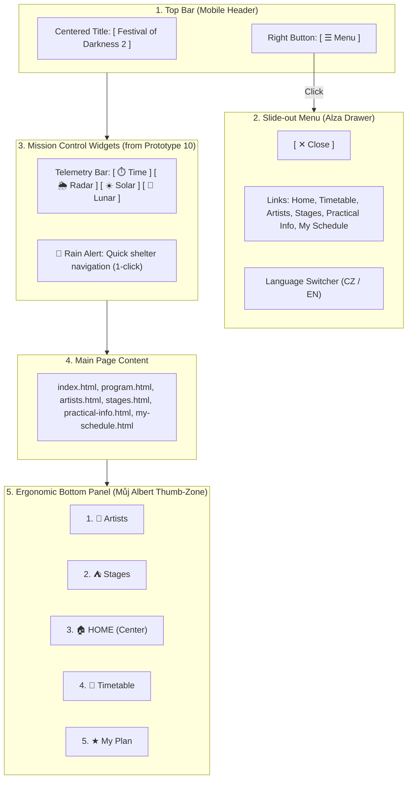
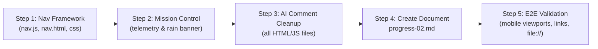

# Website Modification Plan: Festival of Darkness 2 (Based on Screenshot Specification)

This plan details the requirements discussed in the team conversation (RagnaroR & Kzakyz) and outlines specific technical and design steps to prepare the project for **Exercise 3 submission**.

---

## 1. Requirements Analysis from Screenshot

Specific decisions regarding UX, layout, and submission deliverables were agreed upon during the team discussion:

| Area | Initial State | Screenshot Requirement | Chat Rationale |
| :--- | :--- | :--- | :--- |
| **Core Concept** | Standard website / 10 separate prototypes | **Fusion of Prototype 1 (App-Shell) and Prototype 10 (Mission Control)** | *"Personally, I like 1 and 10 the most"* |
| **Top Bar (App Bar)** | Long horizontal row of links across full width | **Festival name centered + Menu button on the right** | *"I'd probably remove that top bar and just leave options on the right... with the page title in the middle"* |
| **Main Menu (Drawer)** | Hardcoded links in the header | **Slide-out side/modal menu (off-canvas drawer) in Alza style** | *"Like here on Alza? You click it and it opens? Yeah."* |
| **Bottom Bar (Dock)** | 6 items with Info at the end | **5 items in exact order, Home in the center ("Můj Albert" app style)** | *"Bottom: artist-stages-home-timetable-myplan. Home, timetable, myplan you need quickly with one hand; artists and stages for the other hand."* |
| **Info Item** | In the bottom navigation | **Removed from the bottom dock**, moved exclusively into the top Alza drawer | *"And removed info from the bottom"* |
| **Mission Control Elements**| Missing from main site (only in L10) | **Incorporate telemetry bar (time, stage status) and Rain Alert** | *"This from 10"* (Radar widget with instant 1-click jump to the sheltered Lunar Dome) |
| **Code Comments** | AI comments ("Scenario 1", "belongs to scenario 2") | **Strict removal of all AI comments and meta-descriptions** | *"He explicitly said he doesn't want comments at all... many sections make no sense, so remove them"* |
| **Submission (Exercise 3)** | Missing `progress-02.md` file | **Draft `progress-02.md`** structured around: features, user needs mapping, validation, and AI usage | Screenshot of official assignment guidelines for Exercise 3 |

---

## 2. Architectural and UX Concept

### Bottom Bar Ergonomics Breakdown (Thumb Ergonomics)
1. **[ 🎤 Artists ]** – Left (catalog exploration, two-handed browsing).
2. **[ ⛺ Stages ]** – Center-left (venue orientation).
3. **[ 🏠 Home ]** – **Directly in the center**, prominent button easily reachable by either thumb (inspired by the *Můj Albert* app).
4. **[ 📅 Timetable ]** – Center-right (quick schedule lookup, single-handed use while walking).
5. **[ ★ My Plan ]** – Right (instant favorite check and collision overview, `★ (n)` counter).

---

## 3. Detailed File-by-File Changes

### A. Components and Navigation (`components/nav.js`, `components/nav.html`)
- **Implement Top Bar:**
  - Create a flexbox container with centered brand identity `[ Festival of Darkness 2 ]` (linking to `index.html`).
  - Right-aligned button `[ ☰ Menu ]` (with appropriate ARIA attributes: `aria-expanded`, `aria-controls="mobile-drawer"`).
- **Implement Slide-Out Drawer (Alza Drawer):**
  - Fixed slide-in panel (from the right or clean modal overlay).
  - Close button `[ ✕ Close ]` + ability to dismiss via backdrop click or `Escape` key.
  - Complete navigation tree: Home, Timetable, Artists, Stages, **Practical Info** (crucial for transit and FAQ), My Schedule.
  - Language toggle (CZ/EN) relocated into the drawer.
- **Implement Bottom Bar (Bottom Nav Dock):**
  - Fixed to viewport bottom (`position: fixed; bottom: 0;`).
  - 5 buttons: `Artists` – `Stages` – `Home` (center) – `Timetable` – `My Plan`.
  - Active page indicator (`.active`).
  - Real-time bookmark counter on `My Plan` synchronized with `localStorage`.

### B. Visual Styles (`css/wireframe.css`)
- **Adherence to Wireframe Guidelines (agents.md):**
  - No heavy shadows, gradients, or non-wireframe decorations.
  - Neither top nor bottom navigation may use a `.wf-box` wrapper; use clean wireframe borders (`border-top: 2px solid #222` for the bottom dock).
  - Prevent horizontal scrolling (`overflow-x: hidden`).
  - Add page bottom padding (`body { padding-bottom: 74px; }`) so the fixed dock never obstructs content or interactive buttons.
- **Styles for Alza Drawer:**
  - Clean wireframe borders, spacious touch targets (minimum 44px height per WCAG standards).
- **Styles for Mission Control Widgets:**
  - Styling for `.telemetry-strip` (monospace font, darker wireframe bar displaying stage statuses and time).
  - Styling for `.rain-shelter-banner` (distinct border for emergency rain response).

### C. Homepage (`index.html`)
- Integrate **Mission Control Header**:
  - Live clock script (`LOCAL TIME: HH:MM:SS`).
  - Radar state: `[ 🌦️ RADAR: RAIN CLOUDS APPROACHING ]`.
  - Stage availability: Solar Horizon Stage (Open-air, open) vs. Lunar Forest Dome (Covered geodesic dome, 100% dry).
  - Emergency rain CTA button: `[ Move to Covered Tent (Lunar Forest Dome) &rarr; ]`.
- Clean up sections and directory cards so the content remains straightforward and grounded in festival needs.

### D. Subpages (`program.html`, `artists.html`, `stages.html`, `practical-info.html`, `my-schedule.html`)
- Automatically inherit the updated navigation scheme (top bar with drawer + bottom dock).
- Verify `padding-bottom` ensures no tables, cards, or filter controls are obscured by the bottom bar.
- Maintain accurate active state in the dock across each page.

### E. Thorough Removal of AI Comments and Scenario Artifacts
- Scan all project files and remove comments such as:
  - `<!-- Scenario 1: Immediate Rain Shelter Quick Action -->`
  - `<!-- Scenario 2: Planner -->`
  - Inline JS/HTML comments referring to AI generation or academic scenario rubrics.
- Code and HTML structure must present as clean, professional teamwork, exactly per course evaluator expectations.

### F. Creation of Mandatory Deliverable Document `progress-02.md`
Per the assignment criteria shown in the chat screenshot, Exercise 3 requires a `progress-02.md` report covering these 4 mandatory sections:
1. **List of Designed Features:**
   - Integrated search and genre filter across all 60 performers.
   - Schedule matrix timetable with day and stage filtering.
   - Personal schedule planner with automatic collision detection.
   - Ergonomic mobile navigation (Alza Drawer + Albert Thumb Dock).
   - Weather triage system (Rain Alert with one-click rerouting to covered venue).
2. **Mapping Features to User Needs:**
   - Mapping to personas and real-world scenarios (attendee caught in rain, festivalgoer navigating crowded grounds one-handed).
3. **What Was Validated and How:**
   - Touch zone reachability (Fitts's Law, thumb reach test), collision algorithm verification, and zero-server execution (`file:///`).
4. **AI Usage and Output Verification:**
   - Documentation of prototype generation, why most variations were discarded, what was synthesized (fusion of 1 and 10), and how AI artifacts were cleaned and refactored manually.

---

## 4. Step-by-Step Implementation Roadmap

1. **Step 1 – Global Navigation Framework:**
   - Update `components/nav.js` and `components/nav.html` to the new architecture (centered title, right-hand Menu trigger with Alza drawer, bottom 5-item Albert dock with Home in center).
   - Add responsive styles, interactive states, and drawer transitions to `css/wireframe.css`.
2. **Step 2 – Mission Control Integration on `index.html`:**
   - Insert telemetry strip and rain warning banner linking directly to the covered Lunar Forest Dome.
   - Activate live festival clock script and interactive trigger.
3. **Step 3 – Code Cleanup and Metadata Removal:**
   - Review all HTML pages to strip out references to scenario numbers and AI generation.
4. **Step 4 – Author Deliverable `progress-02.md`:**
   - Complete the official report addressing all 4 required points from the assignment specification.
5. **Step 5 – Final Verification:**
   - Test responsiveness across mobile viewports (360px – 414px) and desktop.
   - Confirm proper execution under both `http-server` and direct `file:///` filesystem access.
